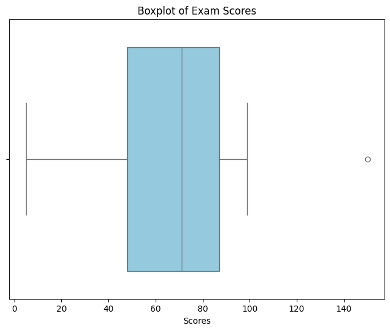
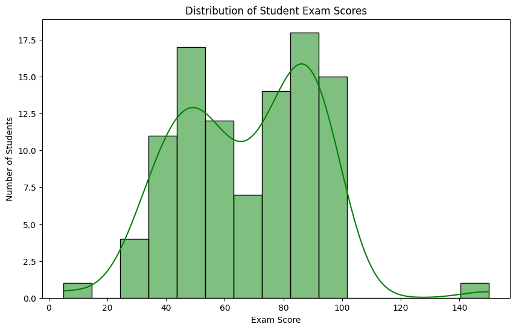
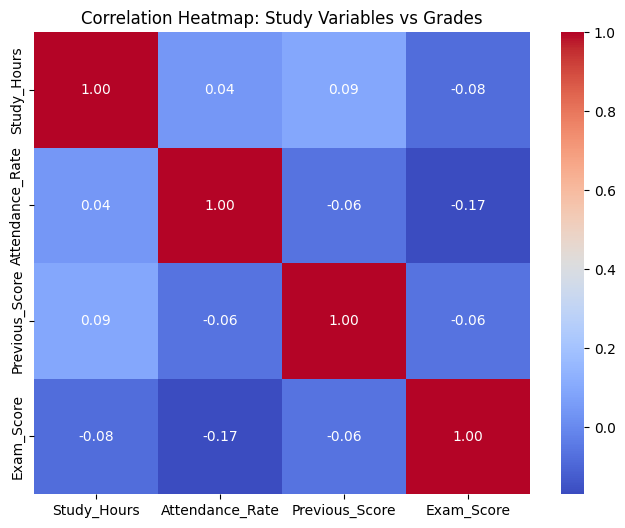

 🎓 Student Exam Performance Data Visualizer

  Python (https://img.shields.io/badge/Python-3.8+-blue.svg)
  
  Pandas (https://img.shields.io/badge/Pandas-Data_Analysis-orange.svg)
  
  Seaborn (https://img.shields.io/badge/Seaborn-Visualization-green.svg)

  📌 Project Overview

  This project is part of the Week 3 Milestone of the Practical Data Science
  & Machine Learning Internship at GetIntern.in. The primary goal is to
  perform Exploratory Data Analysis (EDA) on student performance metrics to
  uncover patterns, identify statistical anomalies (outliers), and determine
  the relationship between study habits and academic success.

  🛠️ Tech Stack

  - Language: Python
  - Environment: Google Colab
  - Libraries:
    - Pandas: For data manipulation and cleaning.
    - NumPy: For numerical operations and synthetic data generation.
    - Matplotlib: For basic plotting.
    - Seaborn: For advanced statistical visualizations.

  📊 Visual Analytics & Key Insights

  1. Outlier Identification (Boxplots)

  Visual:
  

  Technical Takeaways:
  - Detection: Using the Interquartile Range (IQR) method, data points
    falling below $Q1 - 1.5 \times IQR$ or above $Q3 + 1.5 \times IQR$ were
    flagged as outliers.
  - Finding: The analysis revealed extreme anomalies in the Exam_Score
    column, including impossible scores (e.g., > 100), indicating a need for
    data capping or removal before model training.

  ---

  2. Performance Distribution (Histograms)

  Visual:
  

  Technical Takeaways:
  - Trend: The Exam_Score distribution shows a roughly bell-shaped curve,
    suggesting that the majority of students perform within the average
    range (50-80).
  - Observation: The KDE (Kernel Density Estimate) curve confirms a slight
    right-skew, meaning a small number of students achieved exceptionally
    high scores.

  ---

  3. Feature Correlation (Heatmap)

  Visual:
  

  Technical Takeaways:
  - Strongest Driver: A strong positive correlation was observed between
    Study_Hours and Exam_Score, proving that increased study time is the
    primary predictor of higher grades.
  - Secondary Factors: Attendance_Rate also showed a moderate positive
    correlation, suggesting that consistency in class attendance supports
    better performance.

  🚀 How to Run the Project

  1. Clone this repository:
  git clone
  https://github.com/NarenMSD/Student-Exam-Performance-Visualizer.git
  2. Open the .ipynb file in Google Colab or Jupyter Notebook.
  3. Run all cells sequentially to generate the synthetic dataset and the
     visual reports.

  📂 Repository Structure

  ├── Student_Exam_Performance_Analysis.ipynb       # Main analysis notebook
  
  ├── README.md                                     # Project documentation
  
  └── images/                                       # (Optional) Folder containing the 3 charts

  ---
  Submitted by: Narendra Mampa
  
  Internship Track: Data Science
  
  Week: 03 Milestone
